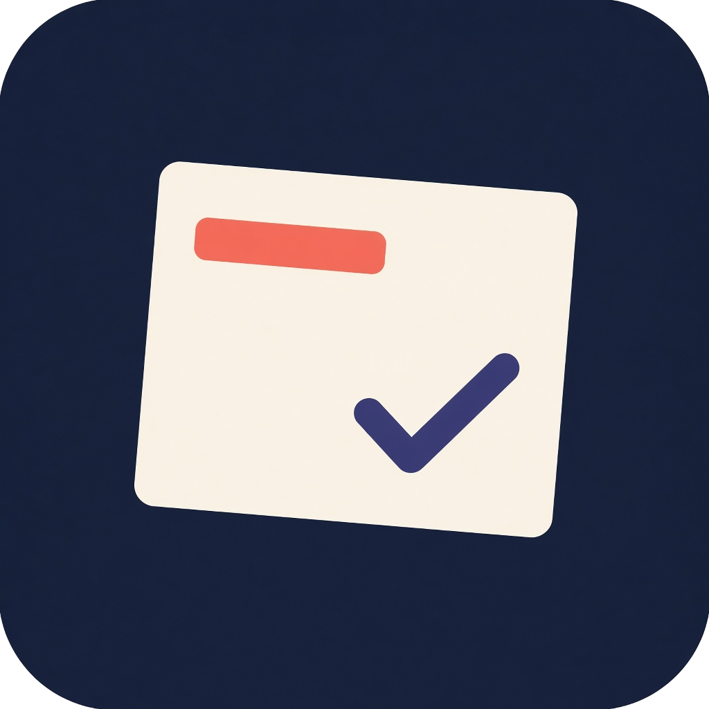

# lv-desktop

A desktop window for the [Lingvist](https://learn.lingvist.com/)
study site. Sit at a desk, with a keyboard and a large display, and
drill vocabulary. Lingvist still teaches: the cards, the audio, and
the scheduling stay on their site. This program keeps one window,
the login, and a shorter pause after a correct answer.

This is an independent client. Lingvist is a trademark of its owner.



## What it does

- Opens the study site in one window.
- Keeps you logged in after a restart.
- Leaves arrows, space, and enter on the cards.
- Moves on sooner after a correct answer.
- Asks once before using the microphone.
- Opens help and payment in your usual browser.

A wrong answer still looks like a wrong answer on the site.

## Run

Install [Nix](https://nixos.org/download/). Clone this repository,
then from its root:

```sh
nix develop
npm start
```

That opens the study site from a checkout. You need a Lingvist
account to study.

## Install

GitHub release `v0.1.0` and later has one package per system and
processor. amd64 is the Intel or AMD 64-bit build. aarch64 is the
ARM 64-bit build.

| System | Package |
| --- | --- |
| Linux | AppImage, deb, or rpm |
| macOS | DMG |
| Windows | MSI |

These files are not signed. macOS has no Apple certificate and is
not notarized. Windows has no Authenticode signature. The first
launch asks you to confirm.

On macOS, copy the app out of the DMG. The first time, open it from
the context menu. On Linux, the AppImage needs FUSE, and deb or rpm
install through the package manager. The arm64 Windows MSI is built
by an x64 installer tool and installs the arm64 app.

## Develop

```sh
npm test
```

That checks the shell and does not open a window. GitHub Actions
runs the same command. Setup, branches, and commit messages are in
[Operations](docs/operations.md).

## License

[GNU General Public License v3.0 only](LICENSE)
([D-0015](docs/decisions.md#d-0015)).

## Contributing

See [CONTRIBUTING.md](CONTRIBUTING.md). To report a vulnerability,
see [SECURITY.md](SECURITY.md).

## Documentation

- [Overview](docs/overview.md)
- [Vision and scope](docs/vision-and-scope.md)
- [Use cases](docs/use-cases.md)
- [Requirements](docs/requirements.md)
- [Architecture](docs/architecture.md)
- [UI design](docs/ui-design.md)
- [Glossary](docs/glossary.md)
- [Roadmap](docs/roadmap.md)
- [Decisions](docs/decisions.md)
- [Pitfalls](docs/pitfalls.md)
- [Operations](docs/operations.md)
